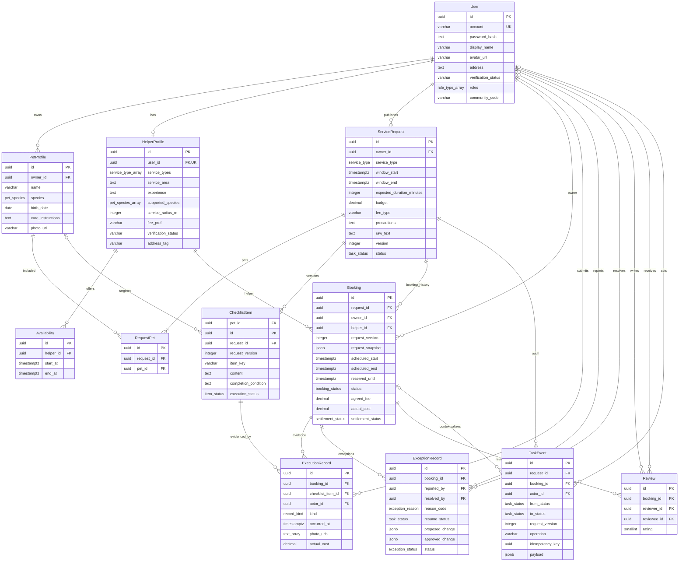

# 邻宠帮 ER 图 v0.2

已按冻结契约同步第 10 周实现口径（12 表、多宠物）；本次补回身份核验、头像与地址、服务半径、费用双轨、禁止事项、原始需求及宠物照片字段，关系与状态设计不变。图中为全部 12 张核心表，字段级约束以数据字典为准，公共审计字段省略展示；连线表示历史数据关系，软删除不解除外键。

多对多关系通过关联实体落实：宠主 User 与帮手 HelperProfile 通过 Booking 构成历史服务多对多；Booking 与 ChecklistItem 通过 ExecutionRecord 构成多对多（同一需求清单可关联历史预约，但仅当前有效预约执行）；User 与 User 通过 Review 构成有方向的评价多对多，同一预约只允许双方各评一次。图中将关联实体展开为两条一对多，另通过 RequestPet 实现需求与宠物的多对多关系。

一个需求通过 RequestPet 绑定至少一只宠物，一次只允许一个有效预约，历史取消预约保留，因此 ServiceRequest→Booking 在历史 ER 中为一对多；一个用户可同时拥有宠物档案与帮手档案，User→HelperProfile 为一对零或一。枚举数组是单实体多值属性，不伪装成跨实体多对多关系。

TaskEvent.actor_id 与 ExceptionRecord.reported_by 可为空以表示系统事件，resolved_by 在异常结案前为空；其他业务外键的非空性见数据字典。ServiceRequest.version 与 ChecklistItem.request_version 是版本归属而非指向当前版本的外键，旧清单、预约快照和事件共同保留历史。
