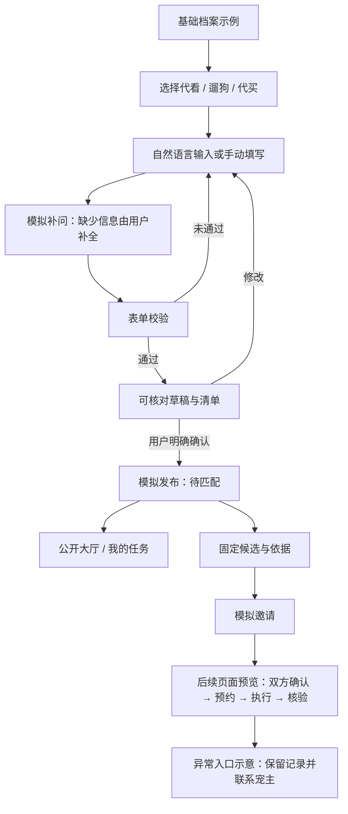

# 第九周 A：页面流程与联调说明

负责人：董韵曦。依据用户提供的《邻宠帮——基于 AI 需求理解与照料清单核验的宠物临时互助平台》第九周分工。交付为页面流程图、Vue 3 + TypeScript 骨架、三类发布表单初稿及模拟数据页面；非第十一周真实闭环。

## 页面流程图

## 页面与交互规则

| 页面       | 第九周实现                       | 后续依赖                               |
| ---------- | -------------------------------- | -------------------------------------- |
| 基础档案   | 年糕（猫）、豆豆（狗）示例       | B 的用户、宠物及帮手接口               |
| 发布需求   | 三类表单切换、必填校验、手动草稿 | C 的解析输出与 B 的创建接口            |
| 草稿核对   | 返回修改、明确勾选后发布         | 保存草稿与 publish 分离调用            |
| 推荐       | 固定模拟候选、经验来源和估计距离 | D 计算候选；不得把固定理由用于真实候选 |
| 大厅与任务 | 会话内模拟需求列表、空状态       | 分页、鉴权、服务端状态                 |
| 执行及异常 | 清单勾选、状态及异常说明预览     | B 的预约、记录、核验与异常接口         |

以单社区、猫狗、单次服务为范围。用户画像中的连续多日场景须拆成单次需求；方案末尾“不涉及宠物出行”与遛狗范围存在表述冲突，暂按明确列出的遛狗功能设计，需组内统一边界文案。

## 字段对照与冻结前待确认

当前参考：用户链接提交 `87d1d772b68e5dad2d4710abc7058133e837ef10` 中 C 的 schema，以及默认分支 `13bda14` 的 B 后端 API 清单。二者不能直接当成同一契约；本次不修改其他成员文件，不宣称已冻结。

| 前端含义     | C 的字段                             | B 的字段 / 接入策略                                                                                   |
| ------------ | ------------------------------------ | ----------------------------------------------------------------------------------------------------- |
| 服务类型     | service_type                         | 同名，home_visit/dog_walking/errand_buy                                                               |
| 宠物         | target_dogs 或 care_items.target_pet | pet_ids UUID 数组；名称仅展示，接入时必须选择真实 ID                                                  |
| 服务时间     | service_time / delivery_time 文本    | window_start/window_end；明确北京时间后序列化带 +08:00 的 ISO 8601，不按浏览器时区猜测                |
| 预计时长     | duration_minutes（遛狗）             | expected_duration_minutes；其他类型补问                                                               |
| 地点         | location / delivery_location         | location，公开大厅不得暴露                                                                            |
| 清单         | care_items 或商品字段                | checklist_items，包含 item_key、position、content、completion_condition、required；由适配层转换并校验 |
| 遛狗固定节点 | pickup/departure/return              | 同名节点，必须保留                                                                                    |
| 代买固定节点 | 商品字段                             | purchase/delivery，商品名称数量单位放清单项                                                           |
| 商品预算     | budget_max                           | 代买时映射到 ServiceRequest.budget；实际商品费用后续记录到 Booking.actual_cost                        |
| 服务费用     | fee_type/budget，代买 schema 缺少    | 三类均需 fee_type；代买发布阶段不存服务报酬，预约时使用 Booking.agreed_fee                            |
| 用品位置     | supplies_location                    | 需明确映射到档案或清单正文，不丢失信息                                                                |
| 路线/行为    | route_note/behavior_notes            | 路线写入 requirements；行为注意与禁止事项写入 precautions                                             |
| 异常联系人   | 部分服务 schema 缺少                 | emergency_contact，各服务均补问                                                                       |
| 原话         | 输入 text                            | raw_text，保持原文；模拟补问按钮只加载演示句                                                          |

前端状态展示最终以 B 返回为准。真实接入顺序：`POST /api/v0/ai/parse` → 用户补全 → `POST /api/v0/requests` 创建 draft → `POST /api/v0/requests/{id}/publish`，带 expected_version。解析 503 时保留用户输入并提示手动填写。错误统一读取 code/message；401 提示登录，403 提示无权限，409 重新拉取版本，422 定位字段。第九周尚未实现网络适配和鉴权。

## 交付与验收脚本

1. 启动前端，看到模拟模式横幅及四个导航入口。
2. 代看：填具体起止时间、30 分钟、地点、联系人、交接、用品位置，逐行填写明确份量的喂食及换水清单。核对页勾选确认后模拟发布。
3. 进入大厅：不应出现地址、联系人、交接内容；进入我的任务可见模拟条目。
4. 返回新建，切换遛狗：仅可选豆豆；填写路线与行为要求，核对接狗/出发/送回三个节点。
5. 切换代买：填写商品规格、数量单位与商品预算；选择有偿服务并填写独立报酬，核对购买/交付两项。
6. 边界：空必填项阻止提交；时间窗口小于时长阻止进入核对；有偿零金额阻止提交；未勾选确认不能发布。
7. 查看固定候选、模拟邀请和后续清单预览；异常说明不修改已发布任务状态。
8. 刷新清空模拟数据是预期行为。所有输入均为演示，不填写真实住址及联系方式。

## 协作记录

已完成 A 侧初稿与对照。B 已确认正式需求字段、预算语义、清单、宠物 ID 与专有信息映射；C 已提供 v1 schema、prompt 和三类响应样例。前端已实现 AI 响应到可编辑草稿的安全映射并保留用户核对步骤；本地 `/ai/parse` 仍为 503 留桩，待可运行 AI 模块接入后验证真实模型调用。
