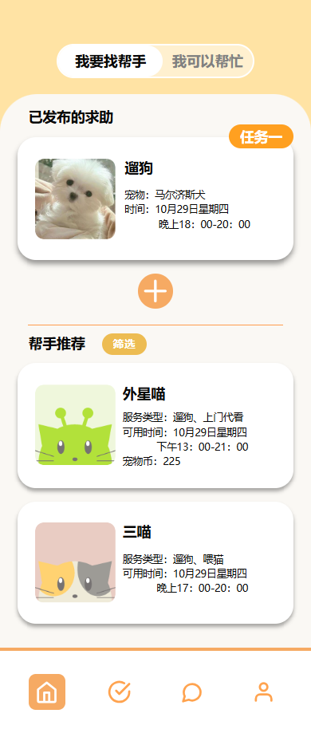
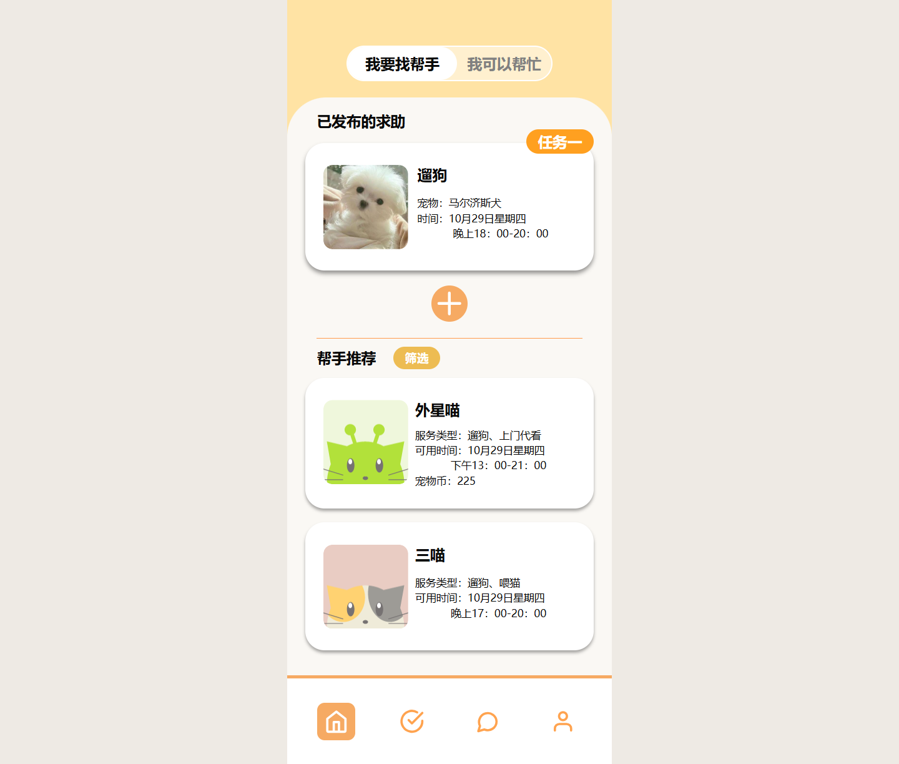

# Prompt 01 验收记录

日期：2026-11-24。基线：main 5c0074a；开发分支：feature/html-integration。

## 修改范围

- 新增 index.html：原样复制设计 HTML。
- 新增 package.json、package-lock.json：独立 Vite 原生 HTML 工程。
- 新增 vite.config.js：开发 5174，预览 4174，仅监听本机。
- 新增 README.md、此记录及手机/桌面截图。
- 原 frontend、backend、数据库均未修改；未调用业务 API。

## 验证结果

- 源文件与 index.html SHA256 一致：368EE101790DBC7AE8599E44DE72D69138B9FF796B31393BADED165088B47A4F。
- npm ci、npm run build 均通过；依赖审计报告 0 vulnerabilities。
- Headless Edge 打开全部 16 个 data-screen 页面成功。
- 宠主/帮手切换和本地聊天演示检查通过；无 pageerror。
- 图片检查初次报告 1 个未加载节点，定位为无 src 且 hidden 的待上传萌宠照片预览，不是损坏的设计图片。
- 已查看手机首页截图，中文和图片显示正常；桌面截图同时留存。
- Windows 下运行中的 Vite 会锁定 Rollup 文件，重新 npm ci 前须先停止开发服务器；停服后重装和构建通过。

## 限制与下一步

这是原型接入验收，不是全流程业务验收。发布、申请、聊天仍为模拟交互，原稿中的示例日期、身份、服务偏好等尚未替换为真实数据。照片上传、所有表单和所有按钮尚未逐一验收。

下一步 Prompt 02：统一 API、开发代理、注册登录、Token 与身份管理；随后进行基础档案接入。由 A 独立完成本地多账号测试，无需等待组员联调。真实模型测试仍需要后端可用的模型配置。

